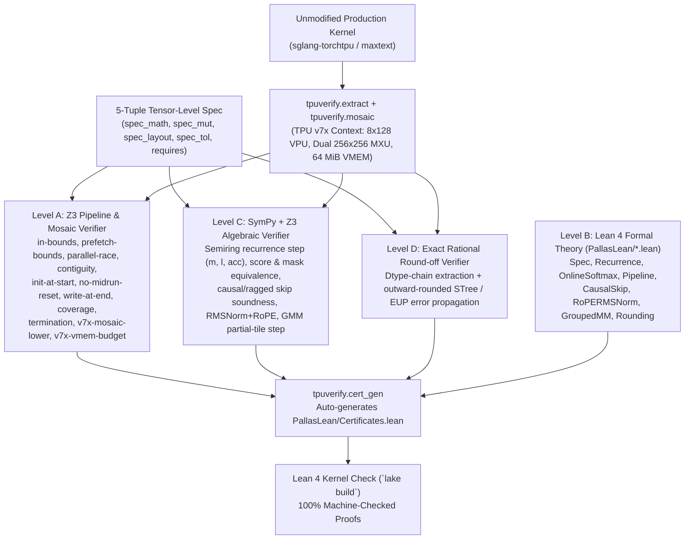

# PallasLean: Formal Verification of Production TPU v7x Kernels in Lean 4

English | [中文](README_zh.md)

**PallasLean** migrates the core philosophy of [TensorLean](https://tensorlean.ai/) (*"From Math to Machine, in Minutes: Formal Verification of Production GPU Kernels"*) from NVIDIA PTX assembly to **Google Cloud TPU v7x (`TPU7x`) Pallas / Mosaic kernels**.

Given an **unmodified** production JAX/Pallas kernel from [`sglang-jax`](https://github.com/sgl-project/sglang-jax), [`sglang-torchtpu`](https://github.com/sgl-project/sglang-torchtpu), [`maxtext`](https://github.com/AI-Hypercomputer/maxtext), [`tpu-inference`](https://github.com/vllm-project/tpu-inference), or `vllm-torchtpu` and a compact **Tensor-Level Specification**, PallasLean verifies the kernel end-to-end across **all four verification layers** (Levels A, B, C, D), compiles it offline to real **TPU v7x Final LLO** via `libtpu`, and emits machine-checked **Lean 4 proof certificates** (`PallasLean/Certificates.lean`).

---

## 1. Why TPU v7x Kernel Verification Is Different from GPU PTX (Pain Points & Disambiguation)

In GPU kernel verification (TensorLean), bugs hide in **fine-grained thread interleavings** (hundreds of threads racing on shared memory across `cp.async`, `mbarrier`, and `wgmma`).

On **TPU v7x (`ChipVersion.TPU_7X`)**, a TensorCore is a **single-threaded VLIW engine** driving:
* Dual **$256 \times 256$ MXUs** (Matrix Multiply Units, accumulating `bf16`/`fp8` into 128 `f32` accumulators),
* A **$8 \times 128$ (sublane $\times$ lane) VPU** (Vector Processing Unit) and **EUP** (Elementary Unit for `exp`/`rsqrt`),
* **64 MiB of VMEM** (Vector Scratchpad Memory) and **1 MiB of SMEM** (Scalar Memory), fed by asynchronous **DMA pipelines** from **103 GB HBM**.

Consequently, production TPU v7x Pallas kernels fail in fundamentally different ways that empirical unit tests rarely catch:

| Dimension | GPU (TensorLean / PTX) | TPU v7x (PallasLean / Pallas Jaxpr + Mosaic MLIR) |
|---|---|---|
| **Target IR** | Compiled PTX assembly (`mma.sync`, `cp.async`, `bar.sync`) | Traced `pallas_call` Jaxpr + lowered **TPU v7x Mosaic MLIR** (`#tpu.core_type<tc>`, `tpu.matmul`, `vector.contract`, `@transform_k`) |
| **Memory Model & Hidden State Hazard** | Relaxed shared/global memory across warps; requires happens-before graph | **Pallas Output-Buffer No-Reload Rule**: Pallas **never** loads an output block from HBM into VMEM when its block index changes—it only flushes VMEM $\to$ HBM on index change or grid end (`PallasLean/Pipeline.lean`). Revisiting an output block non-contiguously or reading `out[...]` before initializing it at the start of a run silently leaks **stale VMEM data from the previous tile**! |
| **Concurrency** | Intra-CTA warp specialization (`mbarrier`) | Cross-TensorCore `parallel` grid dimensions + intra-core DMA double-buffering (`pltpu.make_async_copy` semaphores) |
| **Sublane / Tile Geometry** | 32-thread warp shuffles & swizzled shared memory | **$8 \times 128$ VREG sublane/lane geometry**: causal block skipping (`(r+1)*bq - 1 > c*bk`) is sound *only* under 8-divisible block sizes (`8 ∣ bq` and `8 ∣ bk`, `PallasLean/CausalSkip.lean`) |
| **Floating-Point Arithmetic** | IEEE subnormals or FTZ; unspecified Tensor Core rounding tree | **TPU v7x FTZ (Flush-To-Zero)** on subnormals ($\eta = 2^{-126}$) + 256-deep MXU & 128-lane VPU reduction trees (`STree.err_bound` in `PallasLean/Rounding.lean`) + finite mask constants (`-0.7 * finfo(f32).max`, `PallasLean.mask_approx`) |

---

## 2. Four-Level Verification Architecture



### Level B: Lean 4 Formal Library (`PallasLean/*.lean`)
* [`PallasLean/Spec.lean`](PallasLean/Spec.lean): Formalizes TensorLean's 5-tuple `KernelSpec` (`spec_math`, `spec_mut`, `spec_layout`, `spec_tol`, `requires`), extensional correctness `SatisfiesSpec`, the math-to-machine triangle bridge theorem `satisfiesSpec_of_triangle`, the `assert_cut` rule for `pallaslean_assert`, and TPU v7x hardware parameters (`TPUv7xArch`, `fitsV7xMemory`).
* [`PallasLean/Recurrence.lean`](PallasLean/Recurrence.lean): Commutative semiring linear recurrences $f_{k+1} = a_k \otimes f_k \oplus b_k$, closed-form invariant `linRec_closed`, telescoping products `prod_exp_telescope`, and tropical $(\max, +)$ running maximum `runMax` / `le_runMax`.
* [`PallasLean/OnlineSoftmax.lean`](PallasLean/OnlineSoftmax.lean): Shift-invariant online softmax over arbitrary block boundaries and skip predicates (`osState_closed`, `online_softmax_exact`, `procSum_skip_sound`), finite mask error bound (`mask_approx`: $|(A+a)/(B+b) - A/B| \le 2Vb/B$), and kernel step identities for SGLang FlashAttention (`sglang_fa_step`), MaxText Ragged MQA (`maxtext_ragged_step`, `recentre`), and SGLang Kimi-K3 Attention Residual Decode (`kimi_attn_res_exact`).
* [`PallasLean/Pipeline.lean`](PallasLean/Pipeline.lean): Operational semantics of the Pallas TPU HBM$\leftrightarrow$VMEM output buffer pipeline (`St`, `step`, `run`, `final`), proving `overwrite_is_scatter` (full-overwrite kernels are last-write-wins scatters), `same_block_step` (contiguous accumulation soundness), and `noncontiguous_accumulator_loses` (non-contiguous visits lose prior accumulations).
* [`PallasLean/CausalSkip.lean`](PallasLean/CausalSkip.lean): Proves `skip_sound` (causal block skipping `(r+1)*bq - 1 > c*bk` is sound whenever `8 ∣ bq` and `8 ∣ bk`) and `skip_unsound_odd_block_q` (`bq = 129, bk = 128` drops the diagonal entry $(128, 128)$).
* [`PallasLean/RoPERMSNorm.lean`](PallasLean/RoPERMSNorm.lean): Proves NeoX RoPE 2D pair norm preservation (`ropePair_norm_sq`), relative-position inner-product invariance (`ropePair_dot_rel`), RMSNorm positive scale invariance (`rmsNormElem_scale_pos`), and `V`-column DMA isolation (`qkv_v_slice_disjoint`).
* [`PallasLean/GroupedMM.lean`](PallasLean/GroupedMM.lean): Proves `gmmAcc_closed` ($K$-tile accumulation over $(+, \times)$ semiring), `gmm_partial_tile_two_groups` (two groups sharing a partial $M$-tile compose cleanly when `out` is initialized), and `gmm_uninit_vmem_leak` (omitting `existing_out` leaks stale VMEM buffer contents into unmasked rows).
* [`PallasLean/Rounding.lean`](PallasLean/Rounding.lean): Mixed relative/absolute rounding model $|fl(x) - x| \le u|x| + \eta$ for TPU v7x flush-to-zero, order-independent binary summation tree bound `STree.err_bound`, `mul_err`, `exp_lipschitz`, hardware EUP `ExpModel`, and the 3-edge `triangle` theorem.
* [`PallasLean/Certificates.lean`](PallasLean/Certificates.lean): Auto-generated and machine-checked by Lean 4 during `examples/run_all.py`.

---

## 3. Production Kernels Verified & Bugs Discovered

Running `.venv/bin/python examples/run_all.py` verifies **14 production kernel instances** across `sglang-jax`, `sglang-torchtpu`, and `maxtext` targeting **TPU v7x**:

1. **`sglang.kv_page_write`** (`sglang_tpu/kv_page_write.py`):
   * **PROVED**: HBM bounds, SMEM prefetch bounds, scatter semantics (`Pipeline.overwrite_is_scatter`), termination, TPU v7x Mosaic lowering & VMEM budget.
   * **FINDING (`WARN: unused-input[kv]`)**: `kv` is passed as a pipelined VMEM input block (`BlockSpec`), so the TPU DMA engine copies 256 KiB HBM $\to$ VMEM on every grid step even though `_kv_page_write_kernel` never reads `kv_in_ref`! Passing `memory_space=pl.ANY` eliminates the wasted HBM read bandwidth.
2. **`sglang.qk_norm_rope`** (`sglang_tpu/qk_norm_rope.py`):
   * **PROVED**: All 15 obligations (Level A bounds/coverage/termination/v7x-mosaic/vmem-budget + Level C `C:rmsnorm-rope-exact` + Level D rounding bound $\varepsilon = 0.0157 \le 0.02$).
3. **`sglang.kimi_attn_res_decode`** (`sglang_tpu/kimi_attn_residual.py`):
   * **PROVED**: All 18 obligations (Level A bounds/coverage/termination/v7x-mosaic/vmem-budget + Level C `C:prefix-add` and `C:bank-mixture` proving live bank rows $[0, n_{\mathrm{vb}})$ + pending residual mixture and dead-bank isolation).
4. **`maxtext.ragged_mqa`** (`MaxText/kernels/attention/ragged_attention.py`):
   * **PROVED**: 26 obligations including online-softmax step recurrence (`C:step`, `C:step@init`), score equivalence (`C:score`), skip soundness (`C:skip-sound`), and Level D rounding bound ($\varepsilon = 6.11 \times 10^{-4} \le 10^{-3}$).
   * **BUG 1 (`FAILED: in-bounds[k]`, `in-bounds[v]`)**: Under documented precondition `0 <= lengths[b] <= seq_len`, when the last batch element has `lengths[B-1] < block_size` (e.g. `lengths[7] = 0` or `100 < 256`), `compute_ragged_block_indices` computes `last_good_block = lax.div(length, block_size) - 1 = -1` and clamp-parks `k` and `v` at block index `(7, -1, 0)` (out of range!).
5. **`maxtext.ragged_mqa[requires_len>=256]`**:
   * **PROVED**: Tightening `requires` to `block_size <= lengths[b] <= seq_len` makes all 24 Level A obligations pass with zero errors.
6. **`maxtext.megablox_gmm[no_existing_out]`** (`MaxText/kernels/megablox/backend.py`):
   * **BUG 2 (`FAILED: init-at-start[out]`)**: When `existing_out=None`, `_zero_acc` only zeroes `acc_scratch` and never initializes `out[...]`, yet at `k_i == tiles_k - 1`, `_store_accum` executes `out[...] = jax.lax.select(mask, to_store, out[...])` (a read-before-write on `out`!). Because Pallas never zeroes or reloads an output VMEM buffer on block change, any row where `mask` is False (such as padded tail tokens when `sum(group_sizes) < m` and `num_current_groups == num_total_groups`) leaks **stale VMEM data from the previous `m_tile`** into HBM!
7. **`maxtext.megablox_gmm[with_existing_out]`** (`MaxText/kernels/megablox/backend.py`):
   * **PROVED**: When `existing_out` is provided, `_init_out` seeds `out[...] = existing_out[...]` at the exact start of each `m_tile`'s contiguous run (`k_i == 0` and `first_time_seeing_out`), and all 18 Level A + Level C (`C:gmm-step@init`, `C:gmm-step@final`) + Level D ($\varepsilon = 3.06 \times 10^{-5} \le 2 \times 10^{-4}$) obligations are **PROVED**.
8. **`sglang.flash[vision,single-step]`** (`sglang_tpu/kernels/flash_attention.py`):
   * **PROVED**: All 10 Level A + Level D ($\varepsilon = 0.00847 \le 0.01$) obligations for dense vision single-step FlashAttention.
9. **`sglang.flash[causal,multi-block]`** (`sglang_tpu/kernels/flash_attention.py`):
   * **PROVED**: All 22 Level A + Level C + Level D ($\varepsilon = 0.00442 \le 0.01$) obligations for multi-block causal FlashAttention.
10. **`sglang.flash[causal,ab,q_len=200]`** (`sglang_tpu/kernels/flash_attention.py`):
    * **BUG 3 (`FAILED: in-bounds[ab]`)**: When attention bias `ab` is used with causal masking and `q_len` is not a multiple of `block_q` (`q_len = 200, block_q = 128`, so `ab` has $\lceil 200/128 \rceil = 2$ query blocks), `ab_index_map` Speculatively advances to `next_i = i + 1 = 2` on the skipped upper-triangular step `(grid = [0, 0, 1, 2])`, producing block index `(0, 0, 2, 0)` outside `ab`'s `[1, 2, 2, 4]` block bounds.
11. **`sglang.flash[causal,block_q=129]`** (`sglang_tpu/kernels/flash_attention.py`):
    * **BUG 4 (`FAILED: C:skip-sound`)**: `_verify_block` allows non-multiple-of-8 `block_q` when `block_q == q_seq_len` (e.g. `q_seq_len = block_q = 129, block_k = 128`). Because `below_or_on_diag` uses strict `>` (`(r+1)*bq - 1 > c*bk`, i.e. `128 > 128`, False!), grid step `(0, 0, 0, 1)` is skipped even though query row `128` must attend to diagonal key column `128` (`PallasLean.CausalSkip.skip_unsound_odd_block_q`).
12. **`sglang_jax.megablox_gmm[quant_b2,existing_out]`** (`sgl_jax/srt/kernels/gmm/megablox_gmm_kernel/gmm.py`):
    * **BUG 5 (`FAILED: no-midrun-reset[out]`)**: With `num_quant_blocks >= 2` and `existing_out`, `_init_out` checks `k_i == 0` and `first_time_seeing_out` (ignoring `b_i`), so on `grid = [0, 0, 1, 0]` (`b_i = 1, k_i = 0`) it resets `out[...] = existing_out[...]` mid-run, silently **wiping out quantization block `b_i = 0`'s accumulated output** (`PallasLean.GroupedMM.gmm_quant_midrun_reset_loses_prior_block`).
    * **BUG 6 (Hardcoded Alias Index Crash)**: Line 540 hardcodes `input_output_aliases = {7: 0}`, which crashes with `ValueError` whenever `existing_out` is passed with `rhs_scale=None` or with both `rhs_scale` and `rhs_bias`.
13. **`sglang_jax.megablox_gmm[quant_b1,existing_out]`**:
    * **PROVED**: With `num_quant_blocks = 1`, all 18 Level A + Level D ($\varepsilon = 1.22 \times 10^{-4} \le 2 \times 10^{-4}$) obligations are **PROVED**.
14. **`sglang_jax.update_kv_cache`** (`sgl_jax/srt/kernels/update_kv_cache/update_kv_cache.py`):
    * **PROVED**: Explicit HBM DMA staging (`memory_space=pl.ANY`, `dma_pairs=16`), per-step VMEM scratch buffer (`256.0 KiB / 64 MiB`), and TPU v7x Mosaic lowering (`tpu.enqueue_dma=16, tpu.wait_dma=16`).

---

## 4. Quick Start

```bash
# 1. Build all Lean 4 theories and machine-checked certificates
PATH="$HOME/.elan/bin:$PATH" lake build

# 2. Run the full 3-repo verification suite (generates REPORT.md & PallasLean/Certificates.lean)
.venv/bin/python examples/run_all.py

# 3. Run local Docker (`linux/amd64`) + `libtpu` offline AOT compilation for TPU v7x (`tpu7x:2x2x1`)
#    Dumps real TPU v7x Final LLO (`*-final-top-level-llo.txt`) & Mosaic MLIR without needing a live TPU
./validate/run_local_libtpu_docker.sh
```
