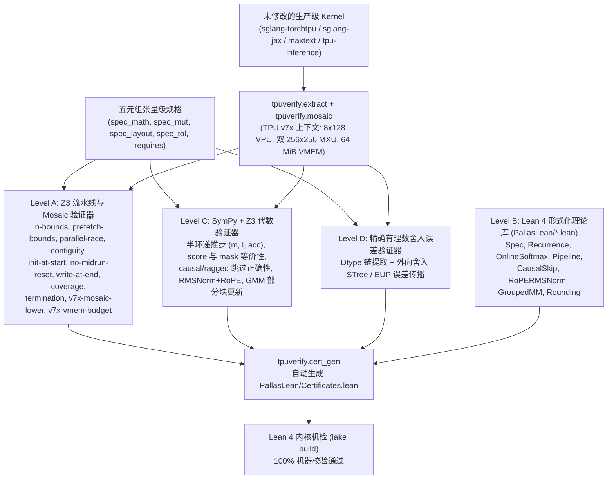

# PallasLean：基于 Lean 4 的生产级 TPU v7x Kernel 形式化验证工具

[English](README.md) | 中文

**PallasLean** 将 [TensorLean](https://tensorlean.ai/)（*"From Math to Machine, in Minutes: Formal Verification of Production GPU Kernels"*）的验证方法迁移到 **Google Cloud TPU v7x（`TPU7x`）Pallas / Mosaic Kernel**。

输入 [`sglang-jax`](https://github.com/sgl-project/sglang-jax)、[`sglang-torchtpu`](https://github.com/sgl-project/sglang-torchtpu)、[`maxtext`](https://github.com/AI-Hypercomputer/maxtext)、[`tpu-inference`](https://github.com/vllm-project/tpu-inference) 或 `vllm-torchtpu` 中**未经修改**的 JAX/Pallas 生产 kernel 代码及张量级规格（Tensor-Level Specification），PallasLean 按四层验证架构（Level A / B / C / D）完成端到端校验，借助 `libtpu` 离线编译生成真实的 **TPU v7x Final LLO**，并输出可由 Lean 4 内核机检的证明证书（`PallasLean/Certificates.lean`）。

---

## 1. 为什么 TPU v7x Kernel 验证不同于 GPU PTX

GPU kernel 验证（TensorLean）主要面对**细粒度线程交错**问题：成百上千个线程通过 `cp.async`、`mbarrier` 和 `wgmma` 竞争共享内存。

**TPU v7x（`ChipVersion.TPU_7X`）** 的 TensorCore 是**单线程 VLIW 引擎**，驱动以下硬件资源：
* 双 **$256 \times 256$ MXU**（矩阵乘单元，将 `bf16` / `fp8` 累加到 128 路 `f32` 累加器）；
* **$8 \times 128$（sublane $\times$ lane）VPU**（向量处理单元）与 **EUP**（初等函数单元，执行 `exp` / `rsqrt`）；
* **64 MiB VMEM**（向量片上缓存）与 **1 MiB SMEM**（标量片上缓存），通过异步 **DMA 流水线**与 **103 GB HBM** 交互。

生产级 TPU v7x Pallas kernel 的失效模式与 GPU 截然不同，常规单元测试很难覆盖：

| 维度 | GPU（TensorLean / PTX） | TPU v7x（PallasLean / Pallas Jaxpr + Mosaic MLIR） |
| :--- | :--- | :--- |
| **目标 IR** | 编译后的 PTX 汇编（`mma.sync`、`cp.async`、`bar.sync`） | Trace 得到的 `pallas_call` Jaxpr + 下沉后的 **TPU v7x Mosaic MLIR**（`#tpu.core_type<tc>`、`tpu.matmul`、`vector.contract`、`@transform_k`） |
| **内存模型与隐式状态风险** | 跨 warp 的弱序共享/全局内存，需要 happens-before 图 | **Pallas 输出缓冲不重载规则**：块索引变化时，Pallas 不会从 HBM 将输出块加载回 VMEM，仅在索引切换或网格结束时将 VMEM 刷回 HBM（`PallasLean/Pipeline.lean`）。非连续重访输出块，或在首次写入前读取 `out[...]`，会静默泄露**前一个 tile 残留在 VMEM 中的旧数据** |
| **并发模型** | CTA 内 warp 分工（`mbarrier`） | 跨 TensorCore 的 `parallel` 网格维度 + 核内 DMA 双缓冲（`pltpu.make_async_copy` 信号量） |
| **Sublane / Tile 几何约束** | 32 线程 warp shuffle 与 swizzle 共享内存 | **$8 \times 128$ VREG sublane/lane 几何约束**：因果块跳过条件 `(r+1)*bq - 1 > c*bk` 仅在块大小为 8 的倍数（`8 ∣ bq` 且 `8 ∣ bk`）时成立（`PallasLean/CausalSkip.lean`） |
| **浮点算术模型** | IEEE 非规格化数或 FTZ；未公开的 Tensor Core 归约树 | **TPU v7x FTZ（非规格化数清零）**（$\eta = 2^{-126}$）+ 256 路 MXU 与 128 路 VPU 归约树（`PallasLean/Rounding.lean` 中的 `STree.err_bound`）+ 有限掩码常量（`-0.7 * finfo(f32).max`，`PallasLean.mask_approx`） |

---

## 2. 四层验证架构



### Level B：Lean 4 形式化理论库（`PallasLean/*.lean`）
* [`PallasLean/Spec.lean`](PallasLean/Spec.lean)：形式化五元组 `KernelSpec`（`spec_math`、`spec_mut`、`spec_layout`、`spec_tol`、`requires`）、外延正确性 `SatisfiesSpec`、数学到硬件的三角不等式桥接定理 `satisfiesSpec_of_triangle`、`pallaslean_assert` 对应的 `assert_cut` 规则以及 TPU v7x 硬件参数（`TPUv7xArch`、`fitsV7xMemory`）。
* [`PallasLean/Recurrence.lean`](PallasLean/Recurrence.lean)：交换半环线性递推 $f_{k+1} = a_k \otimes f_k \oplus b_k$、闭式不变量 `linRec_closed`、望远镜乘积 `prod_exp_telescope` 与 $(\max, +)$ 热带半环最大值递推 `runMax` / `le_runMax`。
* [`PallasLean/OnlineSoftmax.lean`](PallasLean/OnlineSoftmax.lean)：任意分块边界与跳过谓词下的平移不变在线 Softmax（`osState_closed`、`online_softmax_exact`、`procSum_skip_sound`）、有限掩码误差界（`mask_approx`：$\left|\frac{A+a}{B+b} - \frac{A}{B}\right| \le \frac{2Vb}{B}$），以及 SGLang FlashAttention（`sglang_fa_step`）、MaxText Ragged MQA（`maxtext_ragged_step`、`recentre`）与 SGLang Kimi-K3 Attention Residual Decode（`kimi_attn_res_exact`）的单步恒等式。
* [`PallasLean/Pipeline.lean`](PallasLean/Pipeline.lean)：Pallas TPU HBM $\leftrightarrow$ VMEM 输出缓冲流水线的操作语义（`St`、`step`、`run`、`final`），证明全覆写 kernel 等价于 last-write-wins scatter（`overwrite_is_scatter`）、连续累加正确性（`same_block_step`）以及非连续重访丢失历史累加值（`noncontiguous_accumulator_loses`）。
* [`PallasLean/CausalSkip.lean`](PallasLean/CausalSkip.lean)：证明 `skip_sound`（当 `8 ∣ bq` 且 `8 ∣ bk` 时，`(r+1)*bq - 1 > c*bk` 跳过条件成立）与反例定理 `skip_unsound_odd_block_q`（`bq = 129, bk = 128` 会遗漏对角元素 $(128, 128)$）。
* [`PallasLean/RoPERMSNorm.lean`](PallasLean/RoPERMSNorm.lean)：证明 NeoX RoPE 二维配对模长守恒（`ropePair_norm_sq`）、相对位置内积不变性（`ropePair_dot_rel`）、RMSNorm 正缩放不变性（`rmsNormElem_scale_pos`）以及 `V` 列 DMA 隔离性（`qkv_v_slice_disjoint`）。
* [`PallasLean/GroupedMM.lean`](PallasLean/GroupedMM.lean)：证明 `gmmAcc_closed`（$(+, \times)$ 半环上的 $K$-tile 累加）、`gmm_partial_tile_two_groups`（`out` 初始化后，共享部分 $M$-tile 的两个 group 结果正确组合）以及 `gmm_uninit_vmem_leak`（未提供 `existing_out` 时，未覆盖行会泄露 VMEM 残留数据）。
* [`PallasLean/Rounding.lean`](PallasLean/Rounding.lean)：TPU v7x FTZ 混合相对/绝对舍入模型 $|fl(x) - x| \le u|x| + \eta$、顺序无关二叉树求和界 `STree.err_bound`、`mul_err`、`exp_lipschitz`、硬件 EUP 指数模型 `ExpModel` 与三边 `triangle` 定理。
* [`PallasLean/Certificates.lean`](PallasLean/Certificates.lean)：由 `examples/run_all.py` 自动生成并经 Lean 4 校验的证明证书。

---

## 3. 已验证的生产级 Kernel 与发现的缺陷

运行 `.venv/bin/python examples/run_all.py` 可对 `sglang-jax`、`sglang-torchtpu` 与 `maxtext` 中针对 **TPU v7x** 的 **14 个生产级 kernel 实例**完成验证：

1. **`sglang.kv_page_write`**（`sglang_tpu/kv_page_write.py`）：
   * **通过**：HBM 边界、SMEM prefetch 边界、scatter 语义（`Pipeline.overwrite_is_scatter`）、终止性、TPU v7x Mosaic 下沉与 VMEM 预算。
   * **性能发现（`WARN: unused-input[kv]`）**：`kv` 作为流水线 VMEM 输入块（`BlockSpec`）传入，每个 grid step 都会触发 256 KiB 的 HBM $\to$ VMEM DMA 拷贝，但 `_kv_page_write_kernel` 从未读取 `kv_in_ref`。改为 `memory_space=pl.ANY` 可消除多余的 HBM 读带宽消耗。
2. **`sglang.qk_norm_rope`**（`sglang_tpu/qk_norm_rope.py`）：
   * **通过**：全部 15 项验证义务（Level A 边界/覆盖/终止/v7x Mosaic/VMEM 预算 + Level C `C:rmsnorm-rope-exact` + Level D 舍入界 $\varepsilon = 0.0157 \le 0.02$）。
3. **`sglang.kimi_attn_res_decode`**（`sglang_tpu/kimi_attn_residual.py`）：
   * **通过**：全部 18 项验证义务（Level A + Level C `C:prefix-add` 与 `C:bank-mixture`，证明有效 bank 行 $[0, n_{\mathrm{vb}})$ 与待定残差混合正确且无效 bank 隔离）。
4. **`maxtext.ragged_mqa`**（`MaxText/kernels/attention/ragged_attention.py`）：
   * **通过**：26 项义务，涵盖在线 Softmax 递推（`C:step`、`C:step@init`）、score 等价性（`C:score`）、跳过正确性（`C:skip-sound`）及 Level D 舍入界（$\varepsilon = 6.11 \times 10^{-4} \le 10^{-3}$）。
   * **缺陷 1（`FAILED: in-bounds[k]`、`in-bounds[v]`）**：在文档前提 `0 <= lengths[b] <= seq_len` 下，若最后一个 batch 元素满足 `lengths[B-1] < block_size`（例如 `lengths[7] = 0` 或 `100 < 256`），`compute_ragged_block_indices` 会算出 `last_good_block = lax.div(length, block_size) - 1 = -1`，将 `k`、`v` 越界索引到 `(7, -1, 0)`。
5. **`maxtext.ragged_mqa[requires_len>=256]`**：
   * **通过**：将前置条件收紧为 `block_size <= lengths[b] <= seq_len` 后，全部 24 项 Level A 义务均通过。
6. **`maxtext.megablox_gmm[no_existing_out]`**（`MaxText/kernels/megablox/backend.py`）：
   * **缺陷 2（`FAILED: init-at-start[out]`）**：当 `existing_out=None` 时，`_zero_acc` 只清零 `acc_scratch`，从未初始化 `out[...]`；而 `k_i == tiles_k - 1` 时 `_store_accum` 执行 `out[...] = jax.lax.select(mask, to_store, out[...])`（先读后写）。由于 Pallas 在块切换时不会清零输出 VMEM 缓冲，当 `sum(group_sizes) < m` 时，`mask` 为 False 的尾行会将**前序 `m_tile` 残留在 VMEM 中的旧数据**泄露到 HBM。
7. **`maxtext.megablox_gmm[with_existing_out]`**（`MaxText/kernels/megablox/backend.py`）：
   * **通过**：传入 `existing_out` 时，`_init_out` 在每个 `m_tile` 连续访问起始处（`k_i == 0` 且 `first_time_seeing_out`）执行 `out[...] = existing_out[...]`，全部 18 项 Level A + Level C（`C:gmm-step@init`、`C:gmm-step@final`）+ Level D（$\varepsilon = 3.06 \times 10^{-5} \le 2 \times 10^{-4}$）义务均通过。
8. **`sglang.flash[vision,single-step]`**（`sglang_tpu/kernels/flash_attention.py`）：
   * **通过**：单步稠密 Vision FlashAttention 全部 10 项 Level A + Level D（$\varepsilon = 0.00847 \le 0.01$）义务。
9. **`sglang.flash[causal,multi-block]`**（`sglang_tpu/kernels/flash_attention.py`）：
   * **通过**：多块因果 FlashAttention 全部 22 项 Level A + Level C + Level D（$\varepsilon = 0.00442 \le 0.01$）义务。
10. **`sglang.flash[causal,ab,q_len=200]`**（`sglang_tpu/kernels/flash_attention.py`）：
    * **缺陷 3（`FAILED: in-bounds[ab]`）**：开启因果掩码并传入注意力偏置 `ab` 时，若 `q_len` 不能被 `block_q` 整除（如 `q_len = 200, block_q = 128`，`ab` 有 $\lceil 200/128 \rceil = 2$ 个 query 块），`ab_index_map` 使用整除 `q_seq_len // block_q` 判断末块，导致上三角跳过步（`grid = [0, 0, 1, 2]`）将 `next_i` 递增到 `2`，产生越界块索引 `(0, 0, 2, 0)`，在 TPU v7x 实机上触发 core halt。
11. **`sglang.flash[causal,block_q=129]`**（`sglang_tpu/kernels/flash_attention.py`）：
    * **缺陷 4（`FAILED: C:skip-sound`）**：`_verify_block` 在 `block_q == q_seq_len` 时允许非 8 倍数块大小（如 `q_seq_len = block_q = 129, block_k = 128`）。由于 `below_or_on_diag` 使用了严格大于 `>`（`128 > 128` 为 False），`grid = (0, 0, 0, 1)` 被跳过，导致 query 第 128 行漏算对角线 key 第 128 列（`PallasLean.CausalSkip.skip_unsound_odd_block_q`）。
12. **`sglang_jax.megablox_gmm[quant_b2,existing_out]`**（`sgl_jax/srt/kernels/gmm/megablox_gmm_kernel/gmm.py`）：
    * **缺陷 5（`FAILED: no-midrun-reset[out]`）**：当 `num_quant_blocks >= 2` 且传入 `existing_out` 时，`_init_out` 仅检查 `k_i == 0` 与 `first_time_seeing_out` 而忽略 `b_i`，导致 `grid = [0, 0, 1, 0]`（`b_i = 1, k_i = 0`）在中途重置 `out[...] = existing_out[...]`，覆盖掉 `b_i = 0` 已累加的结果（`PallasLean.GroupedMM.gmm_quant_midrun_reset_loses_prior_block`）。
    * **缺陷 6（硬编码 Alias 索引崩溃）**：`input_output_aliases = {7: 0}` 写死了索引 7；当传入 `existing_out` 且 `rhs_scale=None`，或同时传入 `rhs_scale` 与 `rhs_bias` 时，会直接报 `ValueError` 崩溃或错位别名。
13. **`sglang_jax.megablox_gmm[quant_b1,existing_out]`**：
    * **通过**：`num_quant_blocks = 1` 时，全部 18 项 Level A + Level D（$\varepsilon = 1.22 \times 10^{-4} \le 2 \times 10^{-4}$）义务均通过。
14. **`sglang_jax.update_kv_cache`**（`sgl_jax/srt/kernels/update_kv_cache/update_kv_cache.py`）：
    * **通过**：显式 HBM DMA 调度（`memory_space=pl.ANY`，`dma_pairs=16`）、单步 VMEM 临时缓冲（`256.0 KiB / 64 MiB`）及 TPU v7x Mosaic 下沉（`tpu.enqueue_dma=16, tpu.wait_dma=16`）。

---

## 4. 快速开始

```bash
# 1. 编译全部 Lean 4 理论库与机检证明证书
PATH="$HOME/.elan/bin:$PATH" lake build

# 2. 运行完整验证套件（自动生成 REPORT.md 与 PallasLean/Certificates.lean）
.venv/bin/python examples/run_all.py

# 3. 通过本地 Docker (linux/amd64) + libtpu 离线 AOT 编译至 TPU v7x (tpu7x:2x2x1)
#    无需实机 TPU 即可导出真实的 TPU v7x Final LLO (*-final-top-level-llo.txt) 与 Mosaic MLIR
./validate/run_local_libtpu_docker.sh
```
